# Exhibit Builder

The [Exhibit Builder plugin](https://omeka.org/classic/plugins/ExhibitBuilder/){target=_blank} allows you to develop online exhibits, or special web pages, that display and contextualize items from your Omeka Classic site, and may include narrative text, maps, timelines, and other dynamic features.

Exhibits are composed of pages, generally an initial page that introduces your exhibit and subsequent pages composed of items from your Omeka Classic database you wish to highlight and relate to each other. Exhibit Builder exhibits may be as short as one page or consist of multiple pages. You can separate the pages into sections and make hierarchies as well as give the pages a narrative order.

The layout of exhibits in Exhibit Builder is highly customizable, with pages containing smaller units called blocks. There are four basic content blocks: a single file from your items, a file with accompanying text, a gallery of files, and a text block. Other plugins may add their own Exhibit Builder block layouts.

There is a screencast about this plugin that you may find helpful:

<iframe src="https://player.vimeo.com/video/102835560?h=0bbf869f01" style="position:absolute;top:0;left:0;width:100%;height:100%;" frameborder="0" allow="autoplay; fullscreen; picture-in-picture" allowfullscreen></iframe>

<a href="https://vimeo.com/102835560">Omeka Classic: Exhibit Builder 3.0 Plugin</a> from <a href="https://vimeo.com/omeka">Omeka</a> on <a href="https://vimeo.com">Vimeo</a>.

## Configuration

This plugin is included in a downloaded Omeka Classic installation and does not require a separate download. It is included in core installation upgrades, but you may choose to upgrade the plugin separately from your site at any time a new version is released. 

Select "Plugins" in the top navigation of your admin. Activate your plugin and select "Configure" to see two options: 

- **Sorting Exhibits**: Exhibits may be ordered by date added, alphabetically by name, or recent. ("Recent" and "Date Added" are opposites.)
- **Contributor/Researcher Permissions**: Check to allow users at the Contributor and Researcher levels to have access to unpublished exhibits. Note that all exhibits, regardless of author, are available for all other logged-in users at the higher account levels (Super and Admin). 

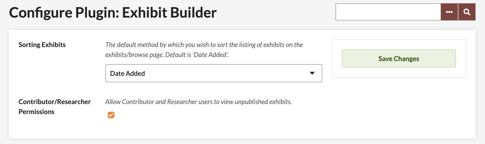

## Add an exhibit

Once you have activated the Exhibit Builder plugin, "Exhibits" appears in the left navigation bar. Clicking on it will take you to the Browse Exhibits page (`admin/exhibits` in your installation). To create an exhibit, go to the Exhibits tab and click the green button labeled "Add an Exhibit". 

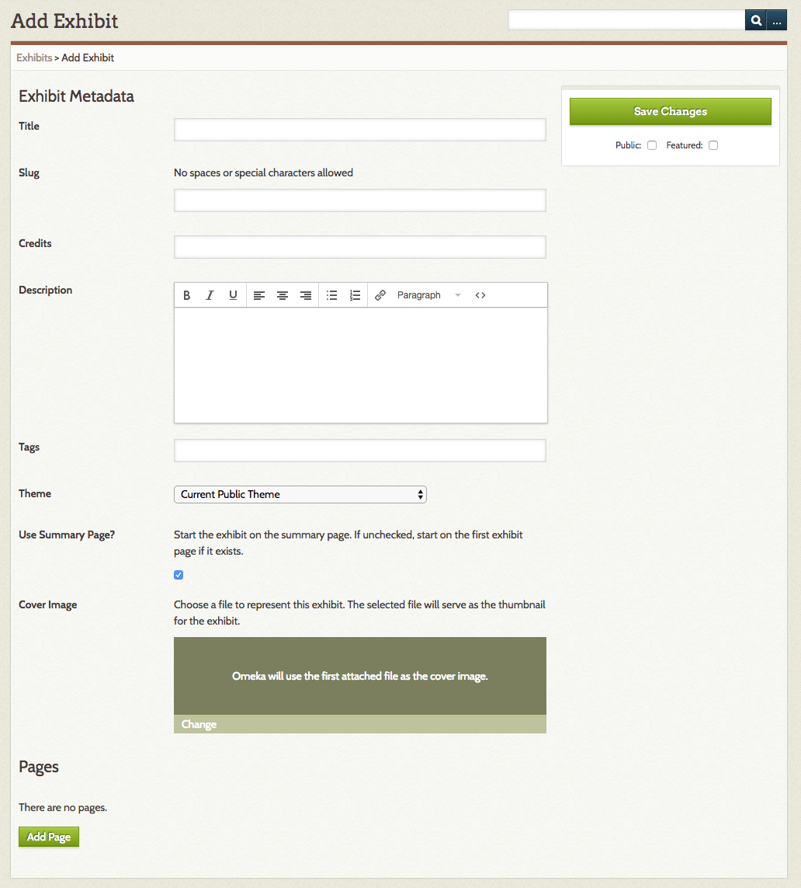

On the "Add Exhibit" page, there are two sections. The first is "Exhibit Metadata":

-   **Title**: The name of your exhibit, which will be displayed to users.
-   **Slug**: A shorter identifier which will appear in the URL, for example `http://youromekasite.org/exhibits/show/exhibit-slug-goes-here`. You can leave this blank and Omeka will generate one from the title. 
-   **Credits**: Acknowledgements, particularly of copyright and authorship. This section appears on the summary page of the exhibit. 
-   **Description**: An introduction or overview for the exhibit. This section appears on the summary page of the exhibit. 
-   **Tags**: Keywords or themes that allow site visitors to browse through your exhibits. These will appear on the "Browse Exhibits" page of your site. 

There is an option to select a **theme** for the exhibit (see below). 

The "**Use Summary Page**" checkbox allows you to decide whether or not to start your exhibit with a summary page. An exhibit summary page displays the exhibit description, credits, and shows the full table of contents of all its pages. If this box is unchecked, site visitors will start on the first page of the exhibit.

Choose a **Cover Image** from your items' files to represent the exhibit on browse pages and elsewhere on your site. This thumbnail must be from an existing item, and will be the first file on that item. 

To the right, under the "Save Changes" button, there are two options - "Public" and "Featured". We recommend you leave your exhibit private until it has pages and been set up completely, but do not forget to make your exhibit public when ready to do so. You may also wish to feature the exhibit on the homepage of your Classic site, alongside featured collections and items, when it is published. 

### Theme

By default, your exhibits will display using the same theme as the rest of the site. You may choose a different theme for each exhibit. To do so, select a theme from the dropdown, which will display "Current Public Theme" as the default. 

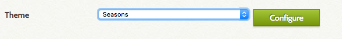

If you select an option other than "Current Public Theme" for your exhibit, you can configure the theme settings for the exhibit by clicking the "Configure" button that appears next to the dropdown.

This theme configuration will show any settings that had previously been chosen at the site level or for other exhibits. This makes it easier to keep your exhibits looking consistent. If you make a change to the theme settings on this page, it will be applied to every exhibit using this theme. 

If you wish this exhibit theme to more closely match the theme used on the rest of your site, you will need to manually upload the same or similar logo and header image (depending on the theme's required image dimensions). You can copy over your general footer text and site copyright information if desired. Or you can set up these options specific to the exhibits portion of your site.

If you have clicked "Configure" and end up on the theme settings page, saving these changes will return you back to the exhibit editing screen you were on earlier. Other changes you may have made to that page will have been saved. 

## Add pages

Once you have created an exhibit, you can add pages to it. Scroll down to the "Pages" section at the bottom of the "Edit Exhibit" page, and click the grey "Add Page" button.

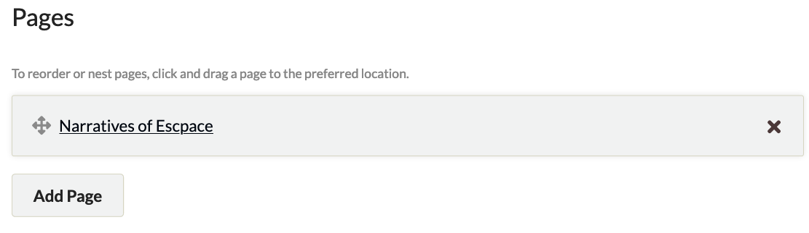

Once on the "Add Page" screen, add the following:

- **Page Title**: A heading that will be visible to users on the page.
- **Menu Link Title**: An optional (likely shorter) term to display in the exhibit's own navigation. You can use these two fields to help structure your narrative in the navigation differently than the way you title your pages. For example, the navigation may simply read eras such as "1918-1938", while the page title is longer and more descriptive. 
- **Page Slug**: An abbreviated page name that appears in the URL, for example `http://youromekasite.org/exhibits/show/exhibit-slug/page-slug`.

You can click the "Save Changes" button to return to this screen and work on it more. To save the basic information for this page and add another page, click the "Save and Add Another Page" button.

### Organize pages

An exhibit in Omeka Classic can have multiple pages. You can reorder these pages by dragging and dropping, and you can use drag and drop to set up exhibit sections and have hierarchies. Note that these hierarchies cannot be more than three levels deep. 

You can also delete pages from the "Edit Exhibit" page through a two-step process. First, click the large black "X" on the display bar of the page you wish to delete. Once you click the "X", the bar will turn red. Clicking the arrow will undo the delete action. To confirm deleting a page, you must click the "Save Changes" button. Once pages have been deleted, they cannot be restored.

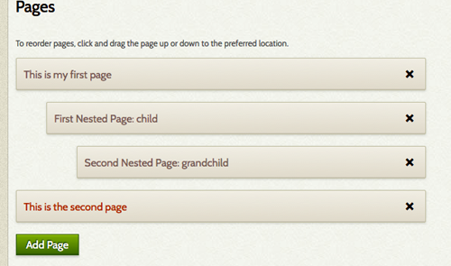

### Exhibit blocks

Pages are built with smaller content units called "blocks". There are four basic kinds of blocks: item(s) with text, an item gallery, a text-only block, and a file-only block. Each page can have one or more content blocks.

Where an item's file is used in an exhibit, it will be a link back to the full item view page. Be aware that this may mean the site visitor moves away from your exhibit - and away from the exhibit's specific theme, into the theme and look of your general site. 

The **File with Text** block allows you to pair full-size or thumbnail files of your items with a block of text. The item files will all be the same size. Text will appear either to the right or left of the files. You can use a single file paired with text, or have multiple files to the right or left of a block of text. 

The **Gallery** block creates a gallery of item files, generally large square thumbnails. You can add text to the gallery, which will display left or right of the gallery. In a gallery block, you can specify a showcase file, which will appear fullsize either to the right or left of the text. The other gallery images can be placed below the showcase image or beside it, over the text.

The **Text** block allows you to create a section of text which spans the width of the entire page.

The **File** block allows you to add larger files as a separate block.

The **Carousel** block creates a slidehow of item files as thumbnails, square thumbnails, or as the full size file. You can pair the file with a caption and/or the item title, and text can be positioned left, right, or center. You can feature up to ten items per slide and adjust the scrolling speed and duration of the slides.

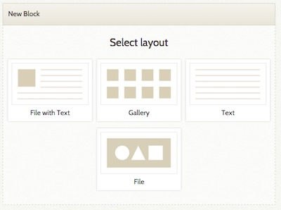

To add a content block, select the layout you want in the New Block dialog box. Once you have selected the kind you want, click the "Add new content block" button. You will have a new block on the page to configure your content.

Some plugins, such as [Geolocation](Geolocation.md) and [Exhibit Image Annotation](ExhibitImageAnnotation.md), will create additional block types which you can select when building a page.

#### Add items
- If you have selected any block other than Text, choose an item by clicking the large plus sign button titled *Add Item* appearing in the Items area.

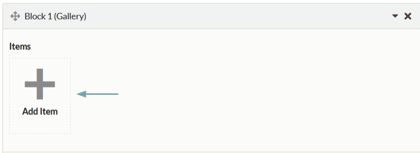

- An items browse dialog box pops up showing all of your items.
   - You can browse using the back and forth arrow buttons in the upper right corner of the dialog box. 

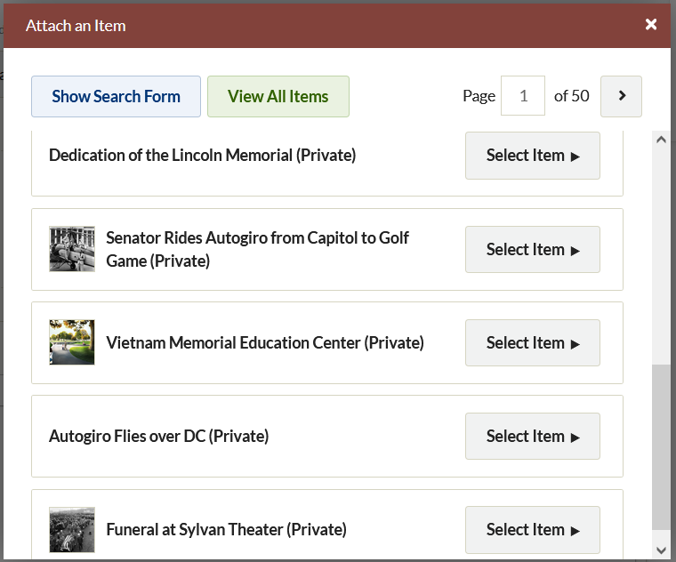
  
- Clicking *Show Search Form* will take you to an advanced item search. 

- To select an item, click on the bar representing it in the Attach an Item window. The right end of the bar will highlight a dark brown "Select Item" button. 

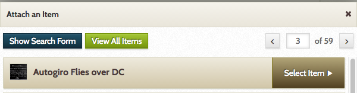

- Click Select Item to find options for selecting a file and creating a caption for the item. 
    - If you have more than one file uploaded for an item, you will be able to select which you want to use by clicking on it.
    - Add a caption in the text field. This will appear in smaller font below the file, not as part of a larger text block. Best practice is to keep it short.
   
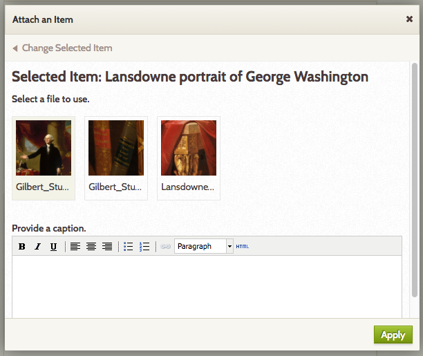

- Click Apply to add the item to the block.

Click the X in the upper right corner of the Attach an Item window at any time to exit the process.

Once you have added an item, you can change the caption or selected file by clicking the edit button which sits across the bottom of the item icon. 

To add multiple files from the same item, simply add the same item to the block, choosing a different file to represent the item each time.

To delete items, click the X in the upper right hand corner of the item icon; this will gray out the icon, indicating that it will be deleted the next time you save changes. If you decide not to delete the item, you can click the curved arrow which replaced the X, but you must do so before you save your changes.

In the image below, the middle item has been marked for deletion. A red arrow points to the X to delete the third item.

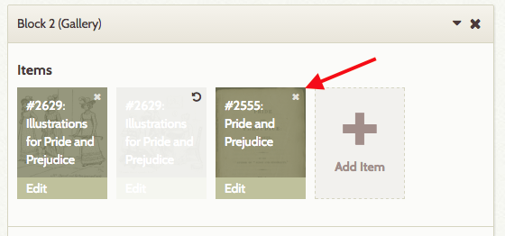

Exhibit text can be formatted using the [text editor bar](../Content/html-editor.md). To write your own HTML, or paste from somewhere else, click the blue HTML button in the formatting toolbar at the top of the text entry box. This will open up an HTML Source Editor window in which you can work.

#### Layout options

The File with Text, Gallery, and Carousel blocks include layout options to change the look of the exhibit page. To access these options, click the black triangle button to the right of the Layout Options text at the bottom of the block. This will reveal dropdown menus with options for changing the layout.

The **File with Text** block has the following options, all of which are drop-down menus (options listed in parentheses after the dropdown label):

- File Position (left, right): a dropdown to select the position of the file relative to the text block.
- File Size (full-size, thumbnail, square thumbnail): a dropdown to select the item file size.
- Captions position (center, left, right): a dropdown to select the position of the file's caption relative to the file (not the text block)
Whatever you select affects all of the files for that block equally. The text in this block will stay fixed to the right or left of the file, but will wrap below if the length of the text exceeds the height of the file.

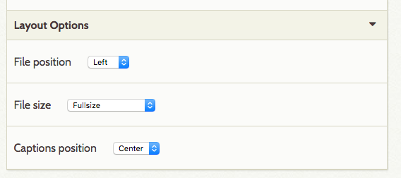

The **Gallery** block has the following options, all of which are drop-down menus (options listed in parentheses after the dropdown label): 

- Showcase File Position (no showcase file, left, right): a dropdown to selec the position of the showcase file. A showcase file is full-size, while the rest of the gallery files are thumbnails. 
- Gallery position (left, right): a dropdown to select the position of the gallery files relative to the showcase file. If there is no showcase file, the gallery will use the full width of the page.
- Gallery File Size (square thumbnail, thumbnail): a dropdown to select the file size for all files in the gallery except the showcase file.
- Captions Position (center, left, right): a dropdown to select the position of the file's caption relative to its file.

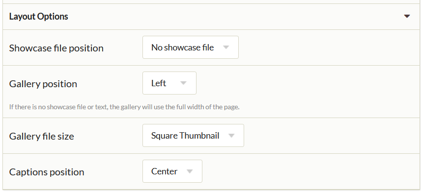

The **File** block has the following options, all of which are drop-down menus (options listed in parentheses after the dropdown label): 

- File Position (left, right, center): a dropdown to select the position of the file relative to page margins.
- File Size (full-size, thumbnail, square thumbnail): a dropdown to select the item file size.
- Captions position (center, left, right): a dropdown to select the position of the file's caption relative to page margins (not the file)

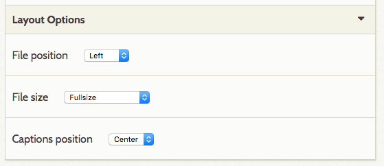

The **Carousel** block has the following options, which are a mix of text boxes, drop-down menus, and checkboxes:

- Carousel title: a text field to enter your title. 
- Items per slide (1-10): a dropdown to select the number of items represented on each slide in the carousel.
- Item file size (thumbnail, square thumbnail, full size): a dropdown to select the item file size.
- Show item title: a checkbox to include the item title on the slide along with the file.
- Overlay caption: a checkbox to overlay the caption on the file (which may require adjusting the CSS settings).
- Caption/title position (center, left, right): a dropdown to select the position of included text relative to the file.
- Stretch image to fill (none, fill width, fill height, fill entire slide): a dropdown to set the image fill.
- Scrolling speed: a text field that sets the speed for the scrolling animation. May be "fast", "slow", or a time in milliseconds. Default is 400.
- Auto slide duration: a text field that sets the time in milliseconds to pause before auto advance. Set to 0 to turn off.
- Loop: a checkbox to make the carousel continually replay.
- Fade between slides: a checkbox that adds a fade effect between slides, but it only works with 1 item per slide.

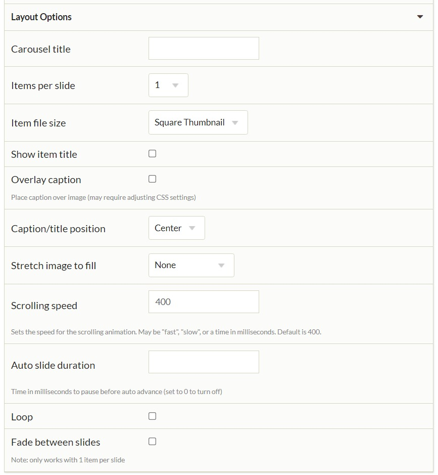

#### Additional layouts
Some plugins include their own Exhibit Builder content block layouts.

##### Geolocation

If you have installed the [Geolocation](Geolocation.md) plugin, you will have the
**Geolocation Map** block as an option in your exhibits. This block has no text. Select items which already have been geolocated using the plugin in their item edit page. This block displays as a map across the full width of the page, with markers for the items you select. Any captions you enter will appear in a pop-up inside the map when the item marker is clicked, as will the item file and title.

This image shows a Geolocation block with items added:
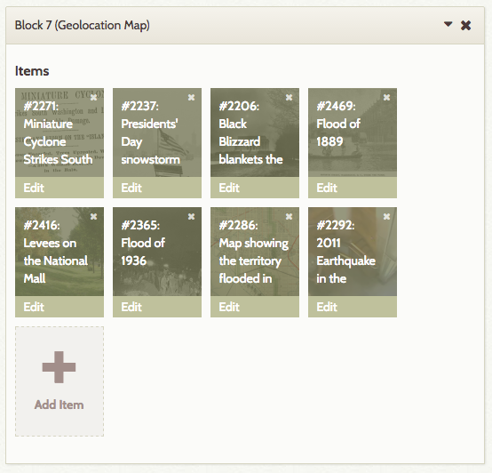

And this is how the map looks on the public view of the exhibit page:
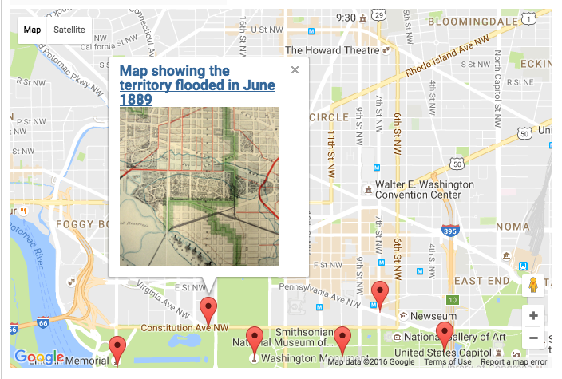

##### Timeline

If you have installed the [Timeline](Timeline.md) plugin, you will have the **Timeline** block as an option in your exhibits. Select one of your previously created timelines from the dropdown menu to add it to your exhibit page. This is how the timeline looks on the public view of the exhibit page (appearance will differ slightly depending on the theme):
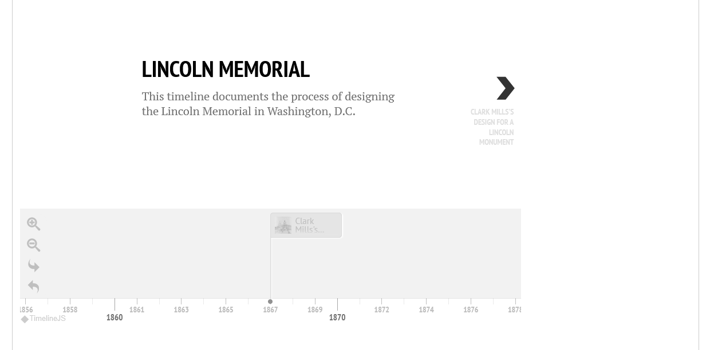

## Shortcodes

Exhibit Builder adds specific [shortcodes](../Content/Shortcodes.md) to your install, which allow you to call specific exhibits or featured exhibits. 

## Previous Exhibit Builder layouts

The following is a list of layouts from previous versions of Exhibit Builder showing how the old layouts can correspond to new content blocks. These correlations are how pages built in previous versions of Exhibit Builder will be imported when upgrading.

Although it is possible to reproduce previous layouts using Exhibit Builder 3.0, the content blocks allow for a much wider variety of layouts. For example, rather than having all the files on one side, as in image list left or right, files could alternate sides. You can also combine a Gallery block with File with Text Blocks, or stack multiple Galleries with interpretive text for each set. 

Note: You cannot change one kind of content block (e.g. Gallery) to a different kind of content block (e.g. File with Text). However, because you can move content blocks around, adding a new block to replace an existing one is less work than in previous versions of Exhibit Builder.

Block layout options are in *italics* for Exhibit Builder 3.0 blocks.

| Exhibit Builder 2 Layout | Exhibit Builder 3.x Layout |
| --- | --- |
| Gallery-full-left 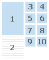 | One gallery block, showcase file position *left*, gallery position *right*. 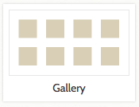  |
| Gallery-full-right 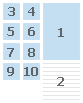 | One gallery block, showcase file position *left*, gallery position *right*.   |
| Gallery-thumbnails 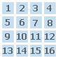 |  One gallery block, no showcase file.   |
| Gallery-thumbnails-text-bottom 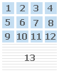| One gallery block with text added, or one gallery block with no text and one text block.   |
| Gallery-thumbnails-text-top 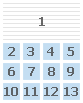 | One text block above one gallery block.  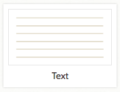 +  |
| Image-list-left 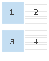 | Series of File with Text blocks, file position *left*, files *full size*   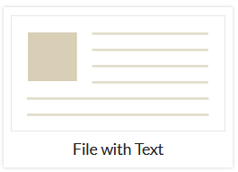 |
| Image-list-left-thumbnails 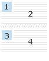 | Series of File with Text blocks, file position *left*, files *thumbnail* or *square thumbnail size*.   |
| Image-list-right 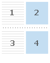 | Series of File with Text blocks, file position *right*, files *full size*.   |
| Image-list-right-thumbnails 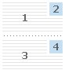 | Series of File with Text blocks, file position *right*, files *thumbnail* or *square thumbnail size*.   |
| Text  | One text block   |
| Text-image-left 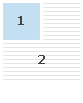 | One File with Text block, file position *left*.   | 
| Text-image-right 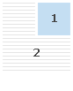 | One File with Text block, file position *right*.   |
