# Geolocation

The [Geolocation plugin](https://omeka.org/classic/plugins/Geolocation/){target=_blank} allows you to assign worldwide locations to items in your Omeka Classic site. The locations can be displayed on maps on individual item pages, in Simple Pages using shortcodes, and on a browsable map of all the geolocated items in your site. Maps can also be added to exhibits. 

There is a [screencast for Geolocation (version 2.2.4) demonstrating its basic functionality](https://vimeo.com/156298642){target=_blank}:

<iframe src="https://player.vimeo.com/video/156298642?h=2fef6d0da4" style="position:absolute;top:0;left:0;width:100%;height:100%;" frameborder="0" allow="autoplay; fullscreen; picture-in-picture" allowfullscreen></iframe>

<a href="https://vimeo.com/156298642">Omeka Classic: Geolocation Plugin</a> from <a href="https://vimeo.com/omeka">Omeka</a> on <a href="https://vimeo.com">Vimeo</a>.

## Configuration

Once you have [installed](../Admin/Adding_and_Managing_Plugins.md) the Geolocation plugin, go to the Plugins tab in the top navigation of your admin dashboard. Scroll down to the listing for Geolocation and click "Configure" (if you do not see "Configure" you may need to click the "Install" or "Activate" buttons).

### General settings

The first section contains the general appearance settings for your maps on both public pages and administrative screens.

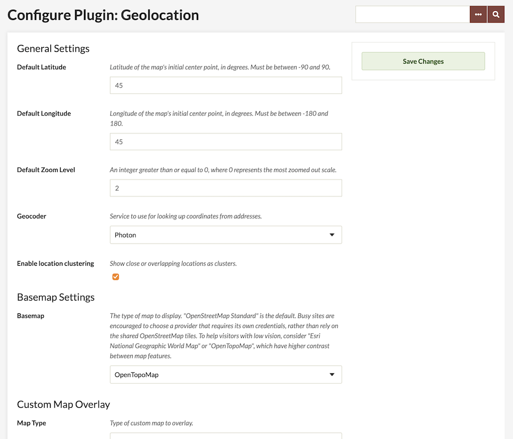

- **Default Latitude**: set the center point of the map's latitude (North/South value), in degrees, between -90 and 90. Using numbers after the decimal point will pinpoint the location more precisely.
- **Default Longitude**: set the center point of the map's longitude (East/West), in degrees, between -180 and 180. Using numbers after the decimal point will pinpoint the location more precisely.
- **Default Zoom Level**: Use a whole number of 0 or greater. 0 is the most zoomed out. A value of 15 will result in a map showing roughly one square mile. Note that some of the visual maps you can choose in the basemap section may not have tiles for high levels of zoom.
- **Geocoder**: Select a service to use for looking up coordinates when an address is entered. The default is "OpenStreetMap Nominatim". You may find other services work better depending on where your work is focused across the globe. 
- **Enable location clustering**: A checkbox. When checked, markers that are very close to each other (at the user's current zoom level) will cluster together and be represented by a number (indicating the number of markers).

A map with "Enable location clustering" unchecked:  
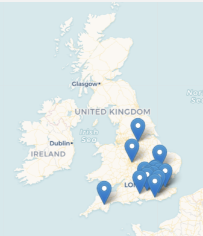

The same map with "Enable location clustering" checked:   
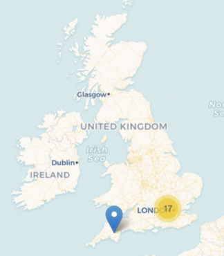

### Basemap Settings

- **Basemap**: Select a visual map from the dropdown to display. All basemaps except those served by Mapbox can be [previewed courtesy of Leaflet](http://leaflet-extras.github.io/leaflet-providers/preview/){target=_blank}.

"OpenStreetMap Standard" is the default. Busy sites are encouraged to choose a provider that requires its own credentials, rather than rely on the shared OpenStreetMap tiles. 

!!! note
	To help visitors with low vision, consider "Esri National Geographic World Map" or "OpenTopoMap", which have higher contrast between map features.

If you select a Stamen option from the dropdown, you will need to [register your domain by going to the provided Stadia link](https://client.stadiamaps.com/signup/){target=_blank}. Stamen basemaps are hosted by Stadia Maps, and Geolocation authorizes them by registered domain rather than by API key.

If you select a CARTO option from the dropdown, you will be asked to enter your:

- **CARTO API Key**: CARTO requires an API key for its basemaps. Without one the tiles are watermarked, so Geolocation displays the default base map instead. Request a key at https://carto.com/basemaps/apikey/. 

If you select Mapbox from the dropdown, two additional fields will appear under general settings: 

- **Mapbox Access Token**: in order to use Mapbox, you need to sign up for their service. Once you have done so, you can go to your [account page](https://www.mapbox.com/account/){target=_blank} and copy your access token to paste into this field. 
- **Mapbox Map ID**: The "map ID" that goes here is the part of a Mapbox "Style URL" that comes after "mapbox://styles/". You can use your own maps or one of the [globally available styles](https://docs.mapbox.com/api/maps/#mapbox-styles){target=_blank}. Leaving this input blank will use the default Mapbox street map.

As of June 1, 2020, Mapbox has deprecated older-style maps. Geolocation 3.2 and up support the newer Mapbox API, and the plugin will automatically update your selected Map ID if you were using one of the "standard" map types. If you had specified a custom map ID, you may need to update it after upgrading Geolocation.

You can use MapBox to create your own map tiles, for example a historic map layer. Please refer to the [MapBox documentation](https://www.mapbox.com/api-documentation/#introduction){target=_blank} for more information.

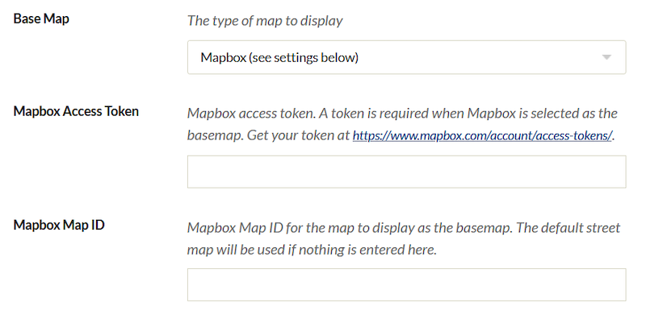

!!! note
	Some maps do not have tiles at a high degree of zoom; be sure to test your chosen basemap on item pages, item set pages, the Map Browse page, and page blocks to be certain it will work for your needs. 

### Custom Map Overlay

Use this section if you wish to add a specific image, already mapped and uploaded elsewhere, as a display layer on all the maps of your site. For example, you can add a historical map that shows relevant areas as they looked in another time. You can use [this list to find example maps to test out this feature](https://www.ncwater.org/GWMS/openlayers/WMS_examples.html){target=_blank}. 

WMS and tile overlays appear as optional visual layers that site visitors can display or hide. Overlays frequently only cover one part of the world map: for example, a historical map of northern Africa that has been digitized and mapped precisely with coordinates, but ends at the Atlantic Ocean. You can have multiple layers all set to be visible by default, whether they overlap each other or not. 

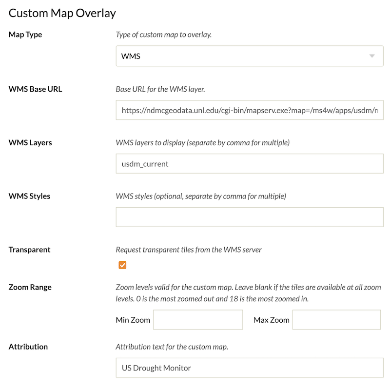

- **Map Type**: Type of custom map to overlay. Specify the standard of the map you wish to use: "Tiled web map" or "WMS". 

- **Tile URL Template**: Paste in the Tile URL for your desired map. This will contain coordinates in the form `(x)`, `(y)`, and `(z)`. For example, `https://mapwarper.net/maps/tile/105449/{z}/{x}/{y}.png` is a [world map from the 1850s](https://mapwarper.net/maps/105449#Show_tab){target=_blank}; the URL is found on the Preview page after the text "Tiles (Google/OSM scheme):". 

or 

- **WMS Base URL**: Paste in the WMS URL for your desired map. For example, `https://ndmcgeodata.unl.edu/cgi-bin/mapserv.exe?map=/ms4w/apps/usdm/map/usdm_current_wms.map` is a map of current USA drought conditions from the [National Drought Mitigation Center](https://droughtmonitor.unl.edu/DmData/GISData.aspx){target=_blank}.

Further WMS configuration fields: 

- **WMS Layers**: This field is required. From the source of your WMS map, find the names of available layers, and enter in as many as you wish to include, separated by commas. The layer names do not need quotes. You must use this field to fetch at least one layer from the WMS map. For example, `usdm_current` for the drought map URL given above. 
- **WMS Styles**: From the source of your WMS map, find the names of available styles if applicable and enter them in here. This field is optional, and many WMS maps do not have styles.
- **Transparent**: If the WMS map provides them, check this box to request transparent map image tiles that will show the basemap wherever the overlay does not cover. 

For both types of maps:

- **Zoom range**: **Min Zoom** and **Max Zoom** can help you narrow down the browsing area to the area of your custom overlay, or a relevant area within it. 
- **Attribution**: Provide attribution text for the custom map. This text will appear in the bottom right corner of the map, alongside the credits for the basemap you have chosen. 

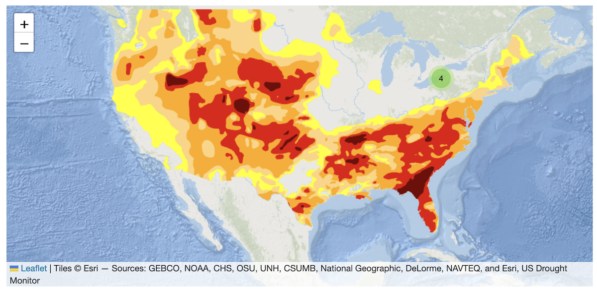
 
### Browse Map settings

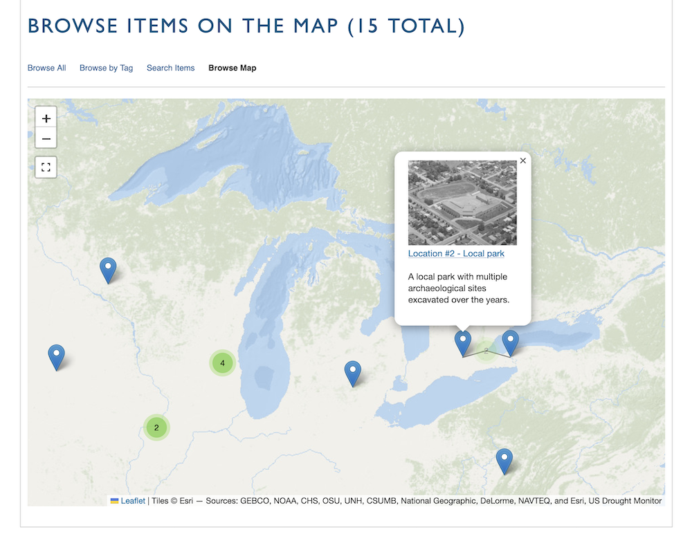

This plugin adds a "Browse Map" page to your site, as well as an administrative screen, which will show all geolocated items. You can add it to your navigation wherever you wish, and have a link to it appear alongside the "Browse by Tag" and other options on your item browsing pages. We provide a relative link to the Browse Map page within your site at the top of this section. 

The settings in this section also influence the "Search by Address function" that Geolocation enables in advanced item search. 

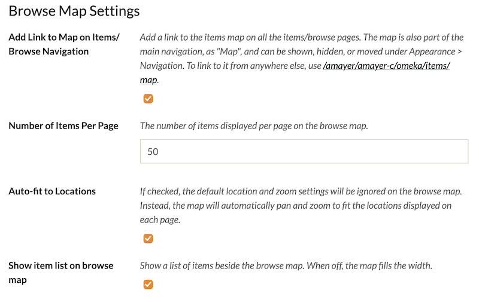

- **Add link to map on Items/Browse navigation**: This will make a "Browse Map" link appear alongside the "Browse Items", "Browse Tags", and "Advanced Search" links at the top of those pages. See the image below in the "View a public map" section. 
-   **Number of Locations Per Page**: The browsable map has pagination; set the number of items per map page with a whole number.
-   **Auto-fit to Locations**: If checked, the browse map will ignore default location and zoom settings designated in General Settings and instead automatically contain all the locations of the items displayed (on that page).
- A checkbox to **Show item list on browse map**, which offers an accessible readout of item titles that are represented on the map as features (pins and shapes). This list will show a number of items according to the "Number of locations per page" setting above, keeping in mind that items can have many locations each. 

### Item map settings

These settings are for the map display on an `item/show` page. 

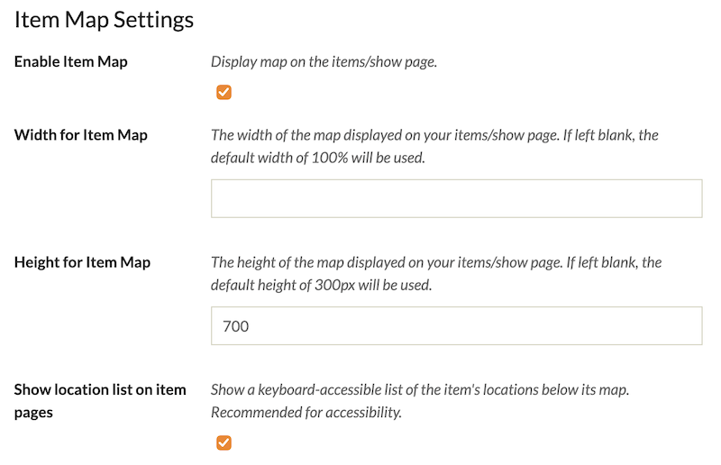

- **Enable Item Map**: Display a map for each item that has one or more map location markers. For items with no geolocation data, the map is not displayed. The placement of the map is governed by each site theme. 
- **Width for Item Map**: set in percentage of the page area's width (which can vary by theme); defaults to 100% (of the available space) if left blank.
- **Height for Item Map**: set in pixels; defaults to 300px if left blank. 
- **Show location list on item pages**: When checked, this adds a list of all map features (pins and shapes) currently attached to the item. This makes it easier for user to access all of the map features, and is recommended for accessibility. 

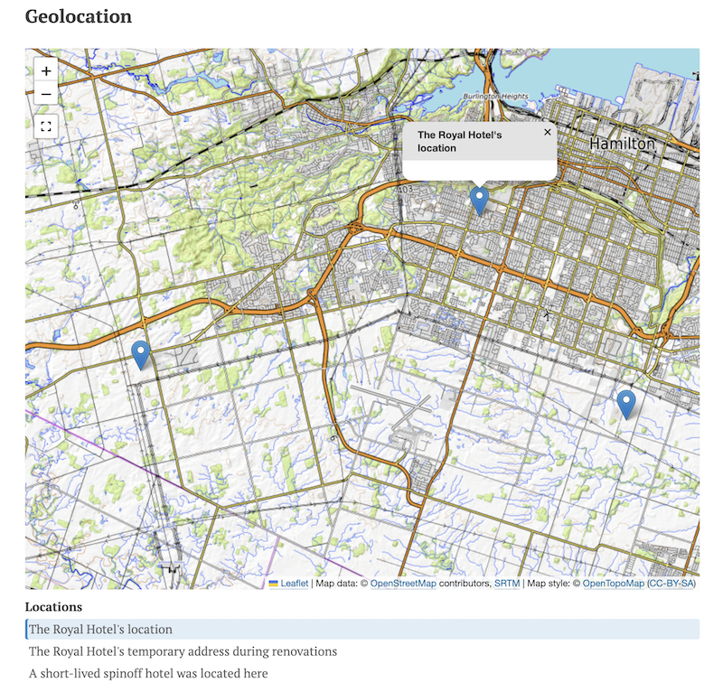

### Search settings

The following three fields are automatically added to public and administrative searches:

- **Geolocation Status**: Users can select to search for only items with locations, or only items without locations.
- **Geographic Address**: Users can type in a location name or address, which will be searched when the form is submitted. This search relies on the service provider set above, in the "Geocoder" field. 
- **Geographic radius**: In either kilometres or miles, users can enter an integer to search within the area of the location they provided in the field above. 

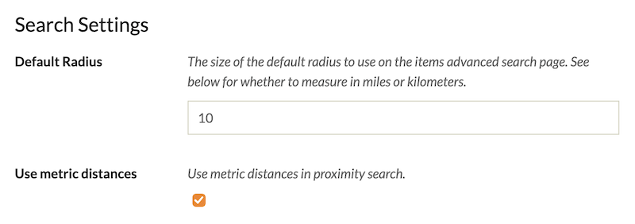

In this section of the configuration page, you can control the settings for these fields: 

-   **Default Radius**: for the Search By Address function in the advanced items search.
-   A checkbox to **Use metric distances** for radius search, rather than miles.

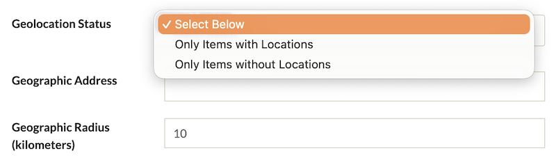

### Map integration

These settings are for integration of the geolocation map into the [Contribution](Contribution.md) plugin's form. 

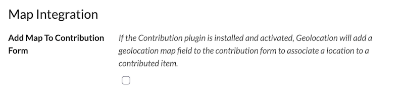

- **Add map to contribution form**: If you have the Contribution plugin installed and active, you can use this setting to add maps to your contribution forms, which enables your users to pin their submissions to locations. They will be able to add pins and shapes, label each feature, and edit and delete their work before submitting the contribution. 

## Geolocate items

After you have activated and configured the Geolocation plugin, you can add locations to your items. 

Geolocation adds a Map tab to the options for adding or editing an item (`admin/item/edit` and `admin/item/add` pages).  When editing an item, click on the Map tab to add locations.

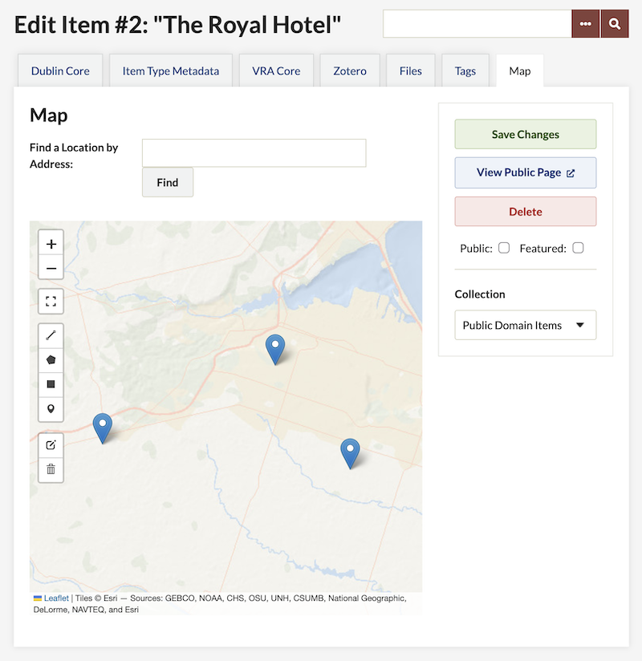

On the tab there is a field for you to **find a location by address** and a map that you can drag to move around, zoom in and out with the plus and minus options (or the scroll wheel on a mouse), and toggle between road and satellite maps. 

To find the location and assign it to the item, you can:

- Enter the address where you want the marker for the item to be placed. The plugin will automatically add a marker at that location. You can use a street address (e.g. "100 First St SE, Washington, DC 20543") or geocordinates in decimal form (e.g. "38.888611, -77.004722").
- Zoom and scroll to navigate to where you want to place the marker, then choose the map feature shape you wish to use (pin, line, rectangle, or polygon), and click directly on the spot on the map. 
	- To add lines, click a start and end spot, then click the "Finish" button that appears on the left hand side to complete the line. 
	- To add rectangles, click to start the shape and then drag your cursor to the opposite corner to add both width and height to your rectangle.
	- To add polygons, click to start the shape and then click as many corners as you wish to add to the shape. Then click the "Finish" button that appears on the left hand side to seal the shape up between the last point you added and the first one you started with.  

You can add as many features (pins or shapes) to the map as you wish, and give them each a custom label indicating the significance of the place relative to the item. 

To remove geolocation from an item, click directly on the marker to highlight it, then click the trash-can icon that appears on the left. A dialog box will ask you to confirm that you want to delete the location assignment. 

!!! note 
	Note that at this time you cannot use [CSV Import](CSV_Import.md) to add location data for use by the Geolocation plugin. Map pins can only be added manually.

Remember to save your changes to the item.

## Map browsing in admin

A "Map" tab appears in the left-side navigation bar of the administrative dashboard. Clicking on the Map tab takes you to a map that displays all geolocated items in your Omeka site, public and not public, and an advanced search form to locate specific items.

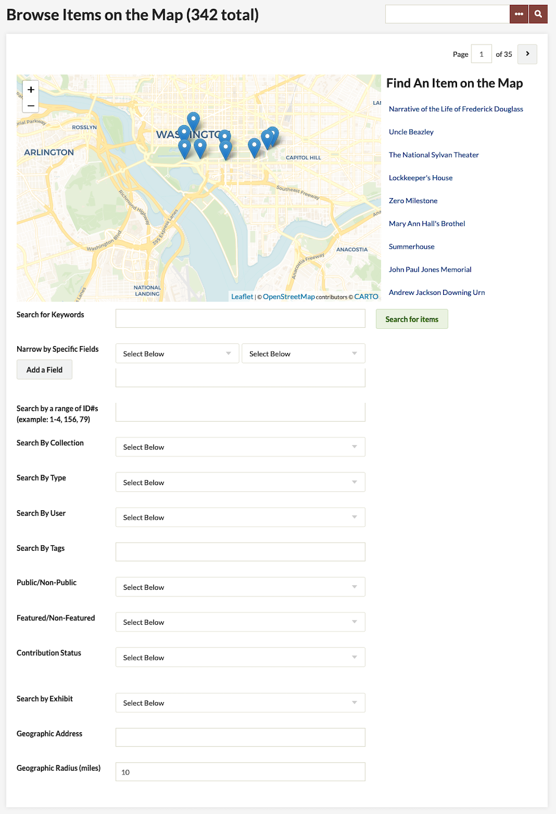

From this view, you may also search mapped items using the item advanced search. Search results appear directly on the map.

## View a public map 

Visitors to your Omeka site can now use a map to browse through all of your geolocated items. The generic map showing all of your items with geolocation metadata can be found at `yourclassicsite/items/map`, which you can enable or disable in your site navigation. Each item's view page will contain a map if the item has at least one location set. 

All maps across the entire site, including Exhibits and Contribution forms, will show the visual settings according to your configuration, including default zoom and latitude/longitude, overlays, and basemaps. Every map has a "Fit all" button that users can press to zoom the map out (or in) far enough to contain all available markers. 

If you enable "Add Link to Map on Items/Browse Navigation" in the plugin configuration, the "Browse Map" link will also be added to the secondary navigation on the `items/browse` page. 

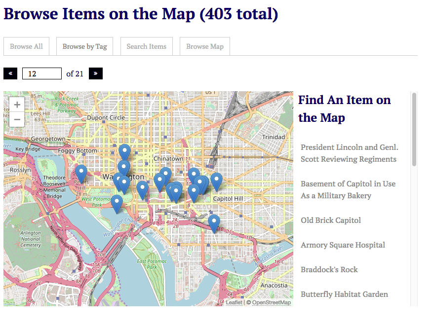

Users can click within the map to see a pop-up on each map feature. These will include the relevant item's title, thumbnail, a truncated description, and any custom label if set. 

If you have enabled it in the plugin configuration, users can click an item title in the right sidebar to move the map. In this sidebar an item with multiple map features will show its title as the list header, then a list showing "Location 1" through "Location X", in the order these locations were added. Locations cannot be reordered when editing the item, only deleted and re-added. 

## Exhibit Builder integration

If you have [Exhibit Builder](ExhibitBuilder.md) (version 3.x or greater) installed, Geolocation will add a Map block to the options when building pages. 

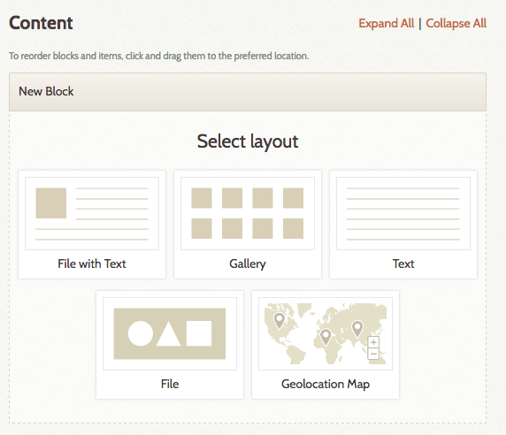

You can add items with geolocation markers to the map block by [adding items](ExhibitBuilder.md#add-items) as you would with any other Exhibit Builder block. The map will ignore items without a location. We suggest you use the search function to filter only to items with geolocation data. 

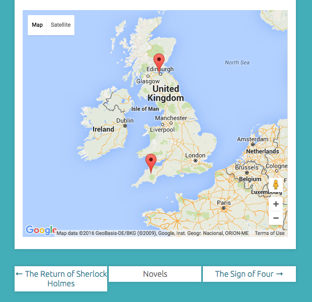

The exhibit will display a single map with the markers for those specific items, centered to display all the items within the map view.

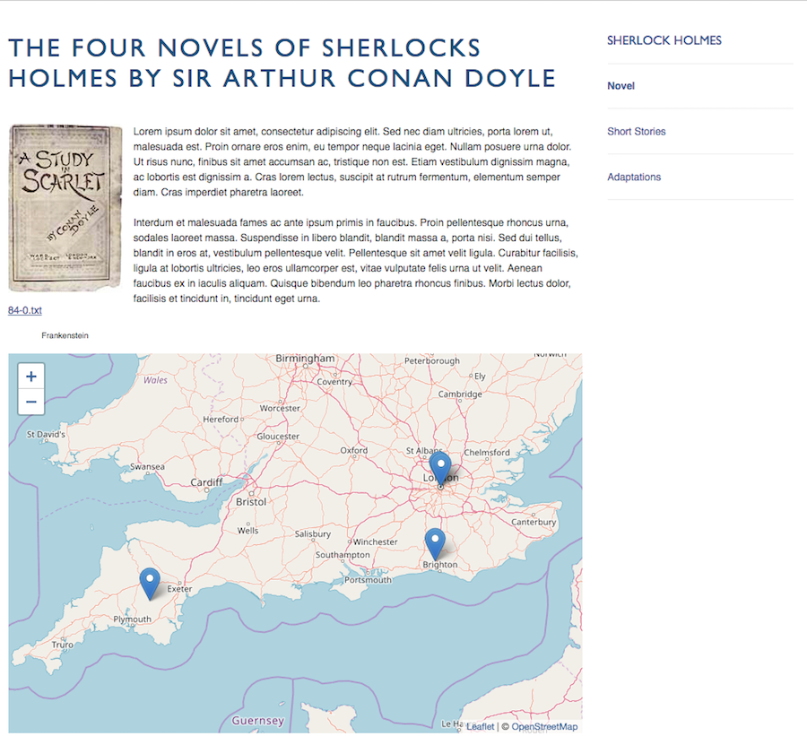

The block has one layout option: **sequence mode**, which adds the ability for users to browse through the map features in order. This order is determined by the order of the items you add to this block, as well as the order of the map features on items with multiple locations. 

If this option is checked, the first item will be centered and its pop-up displayed when the page loads. First, Last, Previous, and Next buttons at the top of the page can be used to navigate through the sequence. An indicator in the middle of the buttons shows the total number of map features (not items), and  where the user currently is in the sequence. 

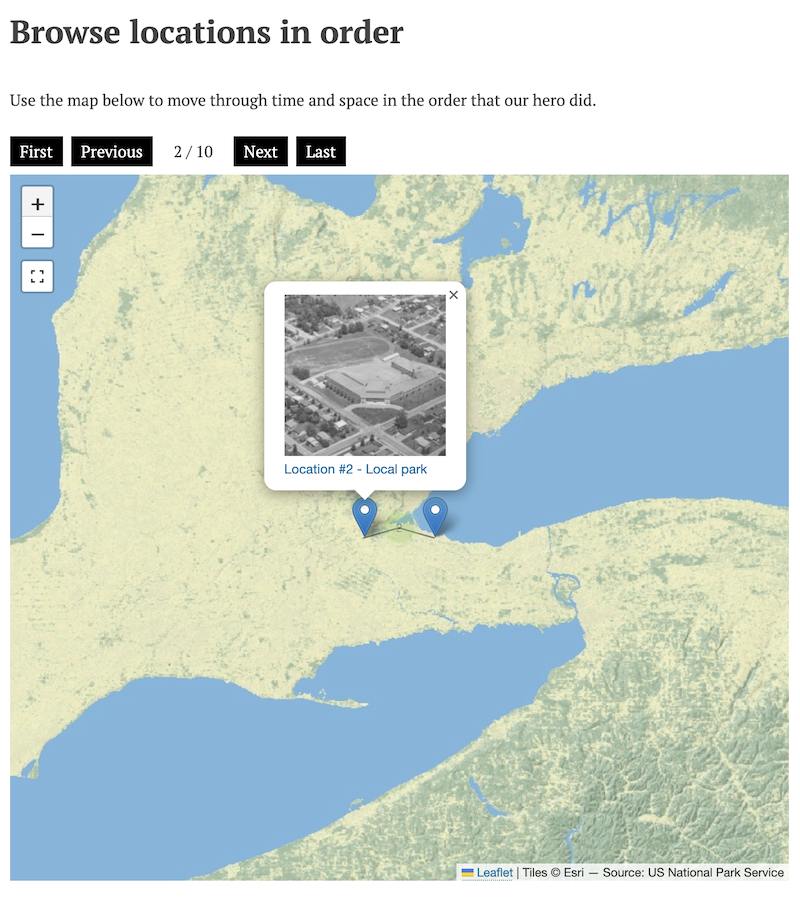

## Shortcodes

The geolocation [shortcode](../Content/Shortcodes.md#geolocation) will create a map of items based on parameters it is given.

The shortcode is `[geolocation]`. Without any additional parameters, it will return a map of all items that contain geolocation data, limited by the records per page as set in the Geolocation plugin configuration. See the relevant section on the Shortcodes page for more information. 
